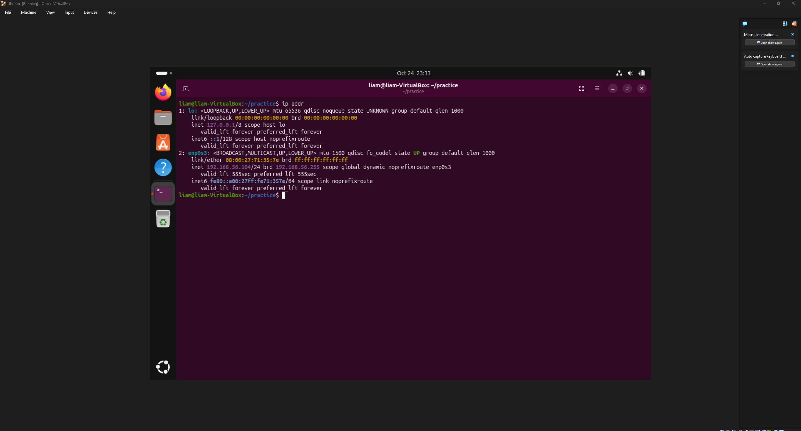

 SSH Remote Access Lab (Windows 10 to Ubuntu)

## Overview
Configured an SSH server on an Ubuntu VM and connected to it remotely from a Windows 10 VM using the built-in Windows SSH client. This simulates how IT administrators manage Linux servers without needing physical access to the machine.

## Environment
| Component | Details |
|---|---|
| Hypervisor | Oracle VirtualBox |
| SSH Server | Ubuntu (VM) - 192.168.56.104 |
| SSH Client | Windows 10 (VM) - 192.168.56.101 |
| Network Type | Host-Only Adapter |
| SSH Port | 22 |
| Software | OpenSSH Server (Ubuntu), OpenSSH Client (built into Windows 10) |

## Objectives
- Configure both VMs on an isolated Host-Only network
- Install and enable an SSH server on Ubuntu
- Verify the SSH service and firewall status
- Confirm connectivity between the VMs with ping
- Connect from Windows to Ubuntu over SSH and run remote commands

## What is SSH?
SSH (Secure Shell) is a protocol that lets you securely control another computer's command line over a network. It encrypts the session, which makes it the standard way to manage Linux servers, and network devices like routers and switches, remotely.

## Steps Taken

### 1. Network Setup
Set both VMs to **Host-Only Adapter** so they can talk to each other while staying isolated from the internet.

Found the Ubuntu IP address:
```bash
ip addr
```


### 2. Install the SSH Server (Ubuntu)
```bash
sudo apt install openssh-server
```
Ubuntu can connect out over SSH by default, but needs this package to accept incoming connections.

### 3. Start and Enable the Service
```bash
sudo systemctl start ssh
sudo systemctl enable ssh
sudo systemctl status ssh
```
The status output showed **active (running)**, confirming the service was up.


### 4. Check the Firewall
```bash
sudo ufw status
```
Checked Ubuntu's built-in firewall to make sure port 22 was not being blocked.


### 5. Test Connectivity (Windows VM)
```
ping 192.168.56.104
```
4 successful replies confirmed the VMs could communicate before attempting SSH.


### 6. Verify the SSH Client (Windows)
Typed `ssh` in PowerShell. The usage options appeared, confirming the client is built into Windows 10.

### 7. Connect From Windows to Ubuntu
```
ssh liam@192.168.56.104
```
On the first connection SSH displays the host fingerprint. Accepting it saves the Ubuntu machine to the Windows known_hosts file. After entering the Ubuntu password the session opened on the Ubuntu command line.


### 8. Run Remote Commands
```bash
whoami
pwd
uname -a
ip addr
ls -la
```
Every command ran on Ubuntu while typed from the Windows VM.


Closed the session with `exit`. The SSH server keeps running, so reconnecting only needs the same ssh command.

## Problem Encountered

| | |
|---|---|
| **Problem** | `sudo apt install openssh-server` failed with "Temporary failure resolving" errors |
| **Cause** | The Host-Only Adapter blocks internet access, so apt could not download the package |
| **Solution** | Temporarily switched the Ubuntu VM to NAT, installed the package, then switched back to Host-Only |


## Commands Reference
```bash
ip addr                         # Find IP on Ubuntu
ipconfig                        # Find IP on Windows
ping <ip>                       # Test connectivity
sudo apt install openssh-server # Install SSH server
sudo systemctl start ssh        # Start SSH now
sudo systemctl enable ssh       # Start SSH on every boot
sudo systemctl status ssh       # Check the service
sudo ufw status                 # Check the firewall
ssh <user>@<ip>                 # Connect to a remote machine
exit                            # Close the SSH session
```

## What I Learned
- How to install, start, and verify an SSH server on Linux with systemctl
- Why a Host-Only network isolates VMs from the internet, and how that affects package installs
- How to check a Linux firewall (UFW) and why port 22 matters for SSH
- What a host fingerprint is and why it should be verified on real networks
- How to run commands on a remote machine, the way IT admins manage servers
- Testing connectivity with ping before troubleshooting higher-level services

## Why This Matters for IT Support
Remote access is part of daily work in IT support and system administration. "Can't connect to the server" tickets are often a stopped service, a blocked port, or a network adapter issue. This lab covered each of those checks.

## Files
- `configs.md` - technical notes and commands from the lab
- `Screenshots/` - evidence of each step
